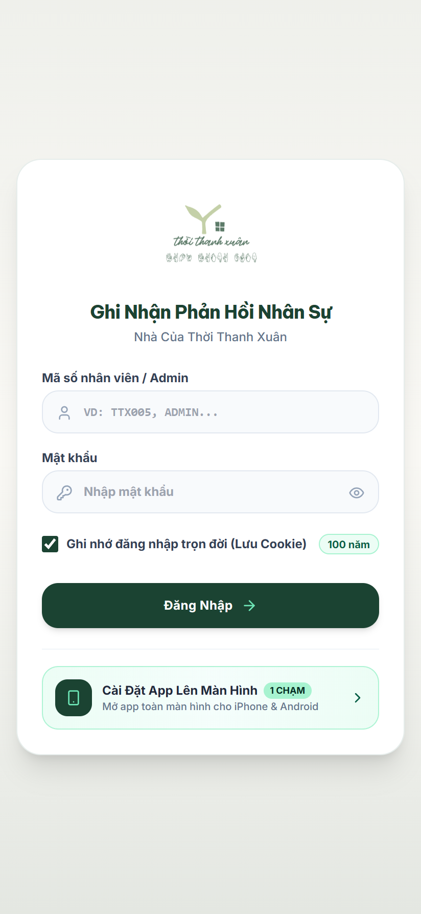
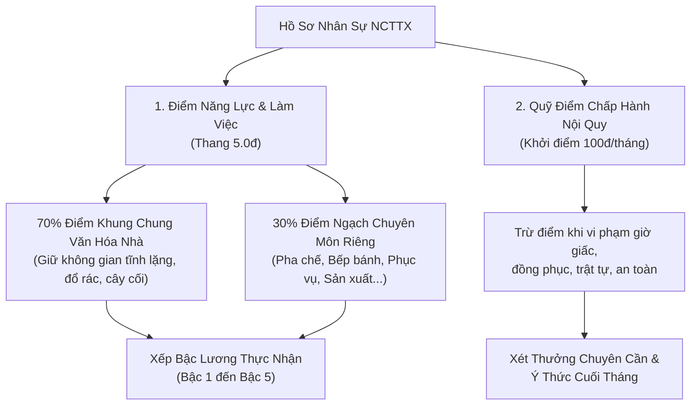
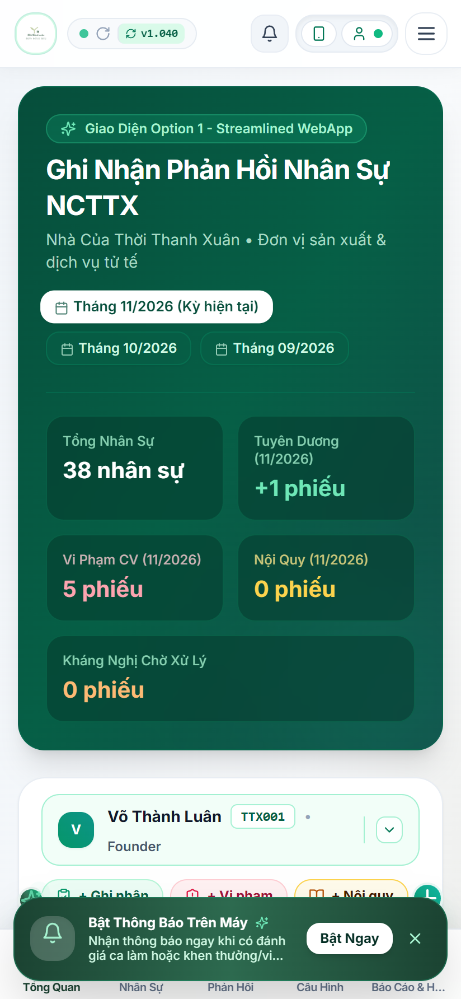
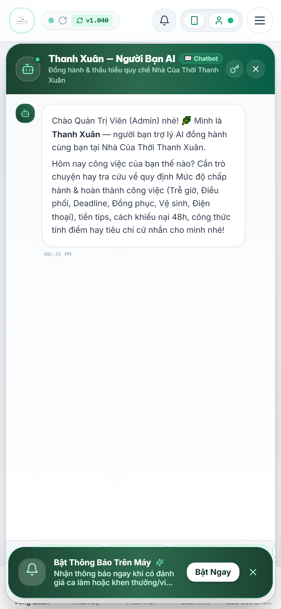

# 📖 SỔ TAY HƯỚNG DẪN SỬ DỤNG ỨNG DỤNG NCTTX STAFFPOINT
### DÀNH RIÊNG CHO TẬP THỂ NHÂN SỰ (NHÀ - QUÁN - XƯỞNG)
**Công ty TNHH Nhà Của Thời Thanh Xuân**  
*Phiên bản: Đồng bộ hệ thống v1.040+ | Dành cho cả Người Nói và Người Điếc / Khiếm Thính*

---

## 🌿 LỜI MỞ ĐẦU THÂN THƯƠNG

Chào bạn – thành viên của đại gia đình **Nhà Của Thời Thanh Xuân**!

Tại **Nhà** (bao gồm **Quán** và **Xưởng**), chúng ta cùng nhau làm việc, chia sẻ không gian tĩnh lặng, mùi hương sả Java, nâng niu từng mầm cây và phục vụ những vị khách ghé thăm bằng cả tấm lòng. Dù bạn là **Người nói** hay **Người điếc / khiếm thính**, mọi nỗ lực, sự cống hiến và sự trung thực của bạn đều là tài sản quý giá nhất của Nhà.

Ứng dụng **NCTTX StaffPoint** được xây dựng ra **KHÔNG PHẢI** để soi xét hay trừng phạt, mà là **công cụ bảo vệ sự công bằng, ghi nhận kịp thời từng việc tốt, giúp bạn tự theo dõi điểm số, bậc lương và đóng góp ý kiến xây dựng Nhà ngày một tốt đẹp hơn**.

> 💡 **Ghi nhớ:** Cuốn sổ tay này được biên soạn ngắn gọn, trực quan, có đầy đủ **hình ảnh giao diện thực tế** chụp trực tiếp từ ứng dụng để bất kỳ ai cũng có thể đọc và sử dụng thành thạo chỉ sau 5 phút!

---

## 📑 MỤC LỤC NHANH
1. [Phần 1: Cài Đặt Ứng Dụng Lên Điện Thoại (iPhone & Android)](#-phần-1-cài-đặt-ứng-dụng-lên-điện-thoại)
2. [Phần 2: Đăng Nhập & Bảo Mật Mật Khẩu Cá Nhân](#-phần-2-đăng-nhập--bảo-mật-mật-khẩu-cá-nhân)
3. [Phần 3: Hiểu Bảng Điểm Của Mình (Thang 5.0đ & Quỹ 100đ)](#-phần-3-hiểu-bảng-điểm-của-mình)
4. [Phần 4: Hướng Dẫn Lập Phiếu Phản Hồi (3 Chức Năng Cốt Lõi)](#-phần-4-hướng-dẫn-lập-phiếu-phản-hồi)
5. [Phần 5: Chấm Điểm Theo Ca Làm Việc (Tích hợp Google Sheet)](#-phần-5-chấm-điểm-theo-ca-làm-việc)
6. [Phần 6: Nhận Thông Báo & Quyền Kháng Nghị Trong 48 Giờ](#-phần-6-nhận-thông-báo--quyền-kháng-nghị-trong-48-giờ)
7. [Phần 7: Tra Cứu Lịch Sử & Sổ Phản Hồi Minh Bạch](#-phần-7-tra-cứu-lịch-sử--sổ-phản-hồi-minh-bạch)
8. [Phần 8: Trò Chuyện & Hỏi Đáp Cùng Trợ Lý AI NCTTX](#-phần-8-trò-chuyện--hỏi-đáp-cùng-trợ-lý-ai-ncttx)
9. [Phần 9: Các Câu Hỏi Thường Gặp (FAQ)](#-phần-9-các-câu-hỏi-thường-gặp-faq)

---

## 📱 PHẦN 1: CÀI ĐẶT ỨNG DỤNG LÊN ĐIỆN THOẠI

Ứng dụng **NCTTX StaffPoint** chạy trực tiếp trên web mà không cần tải từ App Store hay CH Play, nhưng bạn có thể **ghim ra màn hình chính** để mở nhanh như ứng dụng bình thường:

* 🌐 **Địa chỉ truy cập chính thức:** `https://ncttx-staffpoint.vercel.app/`  
* 🌐 **Địa chỉ dự phòng (GitHub Pages):** `https://fongshubvn-cyber.github.io/ncttx-staffpoint/`

*Hình 1: Hộp thoại hướng dẫn ghim app lên màn hình chính cho cả iPhone (Safari) và Android (Chrome).*

### 🍏 Dành cho iPhone / iPad (Trình duyệt Safari)
1. Mở link trên bằng trình duyệt **Safari** (bắt buộc dùng Safari để hiện biểu tượng app).
2. Nhìn xuống thanh công cụ dưới đáy màn hình, bấm vào nút **Chia sẻ** (biểu tượng hình vuông có mũi tên chỉ lên: ⎋ / 📤).
3. Cuộn menu lên và chọn dòng: **"Thêm vào MH chính"** (Add to Home Screen ➕).
4. Bấm **"Thêm"** (Add) ở góc trên bên phải.  
🎉 *Biểu tượng NCTTX StaffPoint sẽ xuất hiện trên màn hình điện thoại của bạn!*

### 🤖 Dành cho Android (Samsung, Oppo, Xiaomi... qua Google Chrome)
1. Mở link trên bằng trình duyệt **Google Chrome**.
2. Bấm vào biểu tượng **Ba chấm dọc (⋮)** ở góc trên bên phải màn hình.
3. Chọn dòng: **"Cài đặt ứng dụng"** hoặc **"Thêm vào Màn hình chính"**.
4. Bấm xác nhận **"Cài đặt"**.  
🎉 *Ứng dụng sẽ được cài đặt và hoạt động mượt mà, hỗ trợ cả khi mạng yếu!*

---

## 🔐 PHẦN 2: ĐĂNG NHẬP & BẢO MẬT MẬT KHẨU CÁ NHÂN

*Hình 2: Giao diện đăng nhập – Điền mã nhân viên, mật khẩu và tích chọn ghi nhớ đăng nhập.*

### 1. Cách Đăng Nhập Lần Đầu
1. Mở app, bạn sẽ thấy giao diện **Ghi Nhận Phản Hồi Nhân Sự**.
2. **Nhập Mã số nhân viên:** Nhập mã cá nhân của bạn (ví dụ: `TTX005`, `TTX009`, `TTX012`...).
3. **Nhập Mật Khẩu:**
   * Mật khẩu ban đầu mặc định của toàn hệ thống là: `123456`
4. **Tích chọn:** `Ghi nhớ đăng nhập trọn đời` để không bị thoát ra khi đóng trình duyệt.
5. Bấm nút **"Đăng Nhập"**.

### 2. Đổi Mật Khẩu Cá Nhân (Bảo Vệ Tài Khoản Của Bạn)
Sau khi đăng nhập bằng mật khẩu mặc định `123456`, hệ thống sẽ yêu cầu bạn đổi mật khẩu mới:
1. Nhập mật khẩu mới (tối thiểu 6 ký tự, không dùng lại `123456`).
2. Xác nhận lại mật khẩu và bấm **"Lưu Mật Khẩu"**.
> ⚠️ **Lưu ý:** Nếu bạn lỡ quên mật khẩu, hãy báo ngay cho Trưởng phòng Nhân sự hoặc Admin để được đặt lại mật khẩu về `123456` nhé!

---

## 📊 PHẦN 3: HIỂU BẢNG ĐIỂM CỦA MÌNH

Ứng dụng chia làm **2 hệ thống điểm độc lập rõ ràng**:

### 1. Màn Hình Trang Chủ / Tổng Quan

*Hình 3: Trang Chủ hiển thị điểm số trung bình, bậc lương cá nhân, bảng xếp hạng và các tác vụ nhanh.*

* **Bảng tổng quan:** Bạn sẽ thấy ngay **Điểm Trung Bình**, **Bậc Lương Hiện Tại (Bậc 1 - Bậc 5)** và **Quỹ Điểm Chấp Hành**.
* **Thanh menu dưới cùng (Mobile Bottom Nav):**
  * 🏠 **Tổng Quan:** Xem tổng hợp điểm và xếp hạng.
  * 👥 **Nhân Sự:** Xem danh sách đồng đội và chi tiết hồ sơ.
  * 🏆 **Phản Hồi:** Xem sổ nhật ký phiếu đã ghi nhận.
  * ➕ **Nút [＋] nổi (FAB):** Bấm để lập phiếu phản hồi ngay lập tức.

### 2. Danh Sách Nhân Sự & Xem Chi Tiết Bảng Điểm

*Hình 4: Danh sách nhân sự theo từng bộ phận (Quán, Xưởng, Dịch vụ...) với điểm trung bình và bậc lương.*

Khi bấm vào thẻ hồ sơ của bất kỳ nhân sự nào, bạn sẽ thấy bảng phân tích chi tiết:

*Hình 5: Bảng phân tích chi tiết điểm số: 70% Khung chung Văn hóa Nhà, 30% Ngạch Chuyên Môn và Quỹ 100đ.*

* **Khung Chung Văn Hóa (Chiếm 70%):** Các tiêu chuẩn cốt lõi của Nhà:
  * 🌿 **Không gian & Âm thanh:** Giữ sự tĩnh lặng, âm lượng vừa phải, mùi hương sả Java.
  * 🌱 **Cây cối & Cảnh quan:** Chăm sóc cây, tưới nước, giữ gìn mầm cây Nhà.
  * 🗑️ **Rác thải & Vệ sinh:** Đổ rác đúng 4 dấu hiệu, phân loại rác, bàn quầy sạch sẽ.
  * 🤝 **Ứng xử & Tương trợ:** Tôn trọng lẫn nhau giữa Người nói và Người điếc/khiếm thính.
* **Ngạch Chuyên Môn Riêng (Chiếm 30%):** Tiêu chuẩn theo đúng bộ phận:
  * *Pha chế / Phục vụ / Bếp bánh / Sản xuất xưởng / Kho & Đóng gói...*
* **Xếp Bậc Lương Dựa Trên Điểm Tổng:**
  * 🌟 **Bậc 5 (Từ 4.80 - 5.00đ):** Hệ số lương **1.05** (Xuất sắc)
  * 🟢 **Bậc 4 (Từ 4.50 - 4.79đ):** Hệ số lương **1.00** (Chuẩn hoàn thành tốt)
  * 🟡 **Bậc 3 (Từ 4.00 - 4.49đ):** Hệ số lương **0.95** (Đạt chuẩn)
  * 🟠 **Bậc 2 (Từ 3.50 - 3.99đ):** Hệ số lương **0.90** (Cần cải thiện)
  * 🔴 **Bậc 1 (Dưới 3.50đ):** Hệ số lương **0.85** (Tập sự / Cần kèm cặp)

### 3. Quỹ Điểm Chấp Hành Nội Quy (Quỹ 100đ)
* Đầu mỗi tháng, mỗi bạn đều có trọn vẹn **100 điểm**.
* Quỹ điểm này dùng để đánh giá ý thức tuân thủ kỷ luật (giờ giấc vào ca, đồng phục, bảo quản tài sản chung, PCCC, không hút thuốc sai nơi quy định).
* Khi vi phạm một điều khoản nội quy, bạn sẽ bị trừ điểm tương ứng (ví dụ: đi trễ trừ 5đ, quên đồng phục trừ 5đ...).
* **Cuối tháng:** Điểm còn lại trong Quỹ 100đ sẽ là căn cứ khen thưởng chuyên cần và xếp loại thi đua tháng.

---

## ✍️ PHẦN 4: HƯỚNG DẪN LẬP PHIẾU PHẢN HỒI (3 CHỨC NĂNG)

Tại góc dưới bên phải màn hình, bấm vào nút tròn nổi bật **`[ ＋ ]`**. Hộp thoại 3 lựa chọn cốt lõi sẽ hiện ra:

*Hình 6: Chọn 1 trong 3 hình thức phản hồi: Ghi nhận & Khen thưởng, Vi phạm công việc, hoặc Đánh giá nội quy.*

### Giao Diện Lập Phiếu Cho Cá Nhân

*Hình 7: Form lập phiếu Cá Nhân – Hệ thống tự điền Người lập và cho phép chọn đối tượng cần ghi nhận.*

### Các Bước Lập Phiếu Chi Tiết:
* **Bước 1 (Thể loại):** Chọn 1 trong 3 nhóm (*🌟 Ghi nhận & Khen thưởng* / *⚠️ Vi phạm tiêu chuẩn* / *📖 Đánh giá nội quy*).
* **Bước 2 (Người lập):** Hệ thống tự động điền tên và mã của bạn (đang đăng nhập).
* **Bước 3 (Đối tượng được lập):**
  * Chọn **`[ 👤 Cá Nhân ]`**: Chọn 1 đồng đội cụ thể trong danh sách.
  * Chọn **`[ 👥 Theo Ca (Sheet) ]`**: Chuyển sang đánh giá cả ca làm việc.
* **Bước 4 (Phạm vi tiêu chí):**
  * *1. Khung chung (Văn hóa Nhà)*
  * *2. Ngạch chuyên môn bộ phận*
  * *3. Ranh giới không thỏa hiệp (đối với vi phạm nghiêm trọng)*
* **Bước 5 (Chọn tiêu chí cụ thể):**
  * Bấm vào các **Nhóm từ khóa gợi ý** (*Không gian, Cây cối, Rác thải, Giờ giấc...*) hoặc gõ tìm kiếm để chọn đúng tiêu chuẩn.
* **Bước 6 (Nội dung chi tiết):**
  * Ghi rõ sự việc diễn ra vào lúc nào, ở đâu, bạn đã hỗ trợ hoặc nhắc nhở ra sao.
* **Bước 7 (Ảnh minh chứng):**
  * Bấm chọn ảnh từ điện thoại nếu có minh chứng cụ thể (tối đa 10MB).
* **Bước 8 (Gửi phiếu):**
  * Bấm nút gửi phiếu để hoàn tất. Hệ thống sẽ lưu an toàn vào **Trường dữ liệu đám mây (Cloud)** và sinh mã phiếu chuẩn hóa.

---

## 👥 PHẦN 5: CHẤM ĐIỂM THEO CA LÀM VIỆC

Khi bạn là Trưởng ca hoặc muốn ghi nhận/nhắc nhở cả ca làm việc cùng bạn hôm nay:

*Hình 8: Chế độ chấm theo ca – Kết nối tự động dữ liệu Google Sheet, chọn ngày, bộ phận và ca làm việc.*

### Cách Sử Dụng Chấm Theo Ca:
1. Tại **Mục 3: Đối tượng được lập**, bấm vào tab **`[ 👥 Theo Ca (Sheet) ]`**.
2. **Chọn Ngày làm việc:** Hệ thống quét sẵn danh sách ngày có lịch làm việc từ Google Sheet.
3. **Chọn Bộ phận:** Chọn bộ phận tương ứng (*Pha chế*, *Bếp bánh*, *Phục vụ*...).
4. **Chọn Ca làm việc:** Chọn đúng ca sáng, ca chiều, số lượng người và địa điểm.
5. **Danh sách nhân sự trong ca:**
   * Mặc định hệ thống tự động tích chọn tất cả thành viên trong ca.
   * Nếu có bạn nghỉ hoặc đổi ca, bạn chỉ việc bấm bỏ dấu tích người đó.
6. **Mã phiếu sinh ra dạng:** `CA-YYMM-XXX` (ví dụ `CA-2611-001`).
   * Từng thành viên được tích chọn đều nhận được thông báo và điểm số được cập nhật đồng loạt.

---

## 🔔 PHẦN 6: NHẬN THÔNG BÁO & QUYỀN KHÁNG NGHỊ TRONG 48 GIỜ

Nhà luôn đặt sự thấu hiểu, minh bạch và tôn trọng lên hàng đầu.

*Hình 9: Trung tâm thông báo (Biểu tượng Chuông 🔔) – Lưu vết mọi phản hồi và thông tin chi tiết.*

### 1. Chuông Thông Báo (🔔)
* Khi có người lập phiếu liên quan đến bạn, biểu tượng Chuông ở góc trên màn hình sẽ báo chấm đỏ kèm số lượng.
* Bấm vào Chuông để đọc chi tiết: Mã phiếu, Người lập, Nội dung và Điểm số tác động.

### 2. Quyền Kháng Nghị & Lắng Nghe Trong 48 Giờ
* Mọi biên bản sau khi lập đều có **thời hạn 48 giờ mở để bạn xem xét**.
* Nếu bạn thấy sự việc chưa chính xác, có hiểu lầm hoặc có lý do bất khả kháng:
  * Bạn có thể gặp trực tiếp Người lập để đối thoại trong tinh thần xây dựng.
  * Hoặc báo Trưởng bộ phận / Quản trị viên Nhà để được hỗ trợ làm rõ.
* Nếu xác nhận là hiểu lầm hoặc nhầm lẫn, Quản lý sẽ hủy biên bản và hoàn lại điểm cho bạn.

---

## 📚 PHẦN 7: TRA CỨU LỊCH SỬ & SỔ PHẢN HỒI MINH BẠCH

Bấm vào mục **"Phản Hồi"** trên thanh menu dưới cùng để mở **Sổ Phản Hồi**:

*Hình 10: Sổ phản hồi – Tra cứu, lọc theo ngày và nhận diện rõ từng mã phiếu chuẩn hóa.*

### Bảng Ký Hiệu Mã Phiếu Chuẩn Hóa:
| Mã Phiếu | Ý Nghĩa | Tác Động Điểm |
| :--- | :--- | :--- |
| **🌟 TD-YYMM-XXX** | Phiếu Tuyên Dương / Ghi Nhận Việc Tốt | **+ Thang 5.0đ** (Cộng điểm công việc) |
| **⚠️ VP-YYMM-XXX** | Biên Bản Vi Phạm Tiêu Chuẩn Công Việc | **- Thang 5.0đ** (Trừ điểm chuyên môn) |
| **📖 NQ-YYMM-XXX** | Biên Bản Vi Phạm Nội Quy Lao Động | **- Quỹ 100đ** (Trừ quỹ chấp hành) |
| **👥 CA-YYMM-XXX** | Đánh Giá Tập Thể Ca Làm Việc | **Thang 5.0đ** (Áp dụng cho cả ca) |

*Bạn có thể bấm vào nút copy bên cạnh mã phiếu để sao chép mã và gửi cho Quản lý khi cần trao đổi.*

---

## 🤖 PHẦN 8: TRÒ CHUYỆN & HỎI ĐÁP CÙNG TRỢ LÝ AI NCTTX

Ở góc dưới bên trái màn hình luôn có biểu tượng **Trợ Lý AI (Nút tròn màu xanh đậm có ngôi sao lấp lánh ✦)**:

*Hình 11: Trợ lý AI – Đặt câu hỏi bằng tiếng Việt để tra cứu nội quy, tiêu chuẩn văn hóa và cách tính lương.*

### Bạn Có Thể Hỏi Bất Kỳ Điều Gì, Ví Dụ:
* *"4 dấu hiệu nhận biết đổ rác của Nhà là gì?"*
* *"Đi trễ bao nhiêu phút thì bị trừ điểm nội quy?"*
* *"Người khiếm thính và người nói khi làm việc chung cần lưu ý gì?"*
* *"Làm sao để tôi được lên Bậc 5 lương?"*
* *"Hôm nay tôi đổi ca thì cần báo ai?"*

Trợ lý AI đã được huấn luyện toàn bộ **Sổ tay nhân sự**, **Nội quy lao động** và **Giá trị cốt lõi** của Nhà, sẵn sàng phản hồi bạn ngay lập tức, ân cần và chính xác 24/7!

---

## ❓ PHẦN 9: CÁC CÂU HỎI THƯỜNG GẶP (FAQ)

### Q1: Tôi là người điếc/khiếm thính, tôi có thể dùng app này không?
> **Trả lời:** **Có, hoàn toàn thuận tiện!** Toàn bộ giao diện app StaffPoint được thiết kế tối ưu bằng hình ảnh, màu sắc trực quan, chữ viết rõ ràng và các nhóm từ khóa gợi ý nhanh. Bạn không cần phải nghe nói mà vẫn có thể chấm điểm, xem điểm, nhận thông báo và gửi phản hồi 100% qua màn hình điện thoại.

### Q2: Nhân viên có được quyền lập phiếu khen thưởng cho Quản lý không?
> **Trả lời:** **Được!** Văn hóa Nhà khuyến khích sự trung thực và bình đẳng hai chiều. Bất kỳ ai làm tốt đều xứng đáng được ghi nhận và tuyên dương.

### Q3: Em bị người khác lập biên bản hiểu lầm thì làm sao?
> **Trả lời:** Đừng lo lắng! Bạn có **48 giờ** để giải trình. Hãy bấm vào thông báo để xem rõ mã phiếu và nội dung, sau đó trao đổi lại với người lập hoặc báo Trưởng bộ phận để cùng lắng nghe và đối soát sự thật.

### Q4: Điểm tổng của em có ảnh hưởng trực tiếp đến thu nhập không?
> **Trả lời:** **Có!** Điểm tổng (Thang 5.0) quyết định Bậc lương (Bậc 1 đến Bậc 5) kèm hệ số nhân lương tương ứng. Làm tốt, tích lũy điểm cao sẽ giúp bạn tăng bậc lương xứng đáng.

### Q5: Khi không có mạng Wifi/4G thì app có chạy được không?
> **Trả lời:** App đã được tích hợp bộ nhớ Offline Cache. Khi mất mạng tạm thời, bạn vẫn có thể mở app xem lịch ca và bảng điểm đã lưu. Khi có mạng trở lại, hệ thống sẽ tự động đồng bộ lên Đám mây.

---

*“Mỗi ngày bước vào Nhà, chúng ta không chỉ làm một công việc, mà đang cùng nhau gìn giữ một nơi chốn bình yên và tử tế.”*  
**Chúc bạn có những ngày làm việc thật vui vẻ, tràn đầy năng lượng tại Nhà Của Thời Thanh Xuân!** 🌿☕✨
