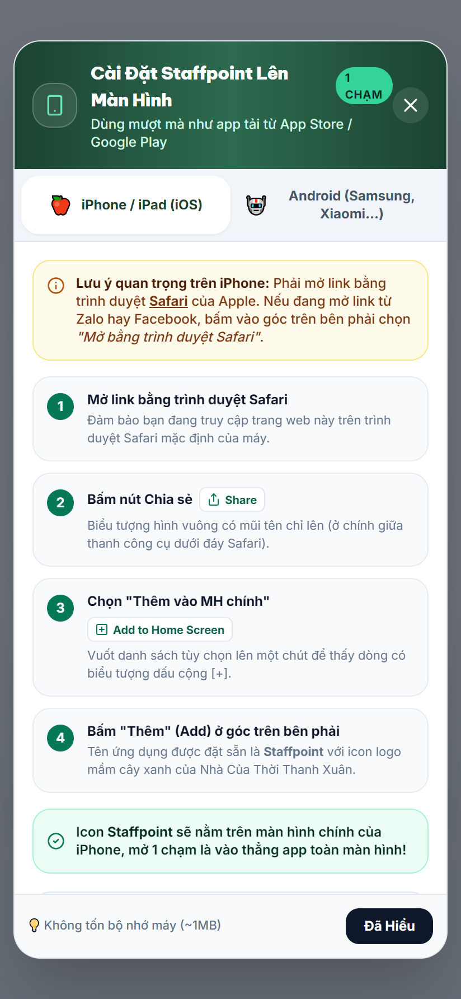
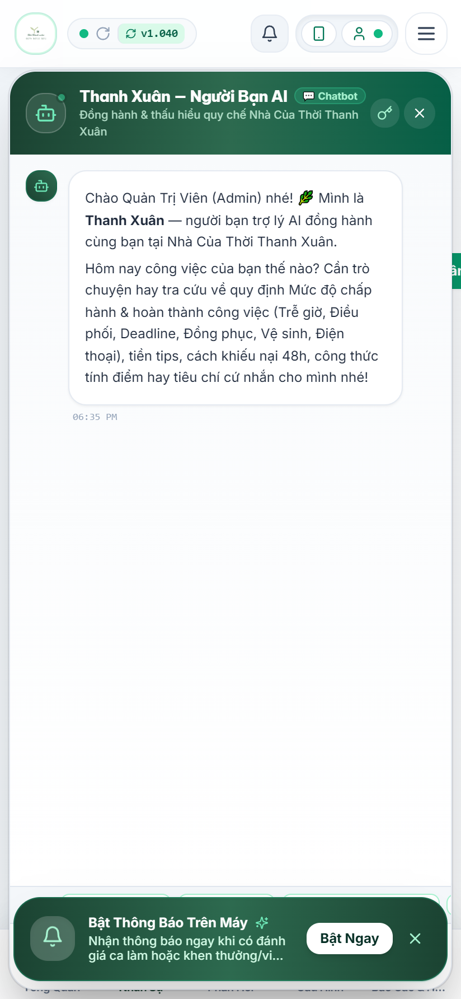
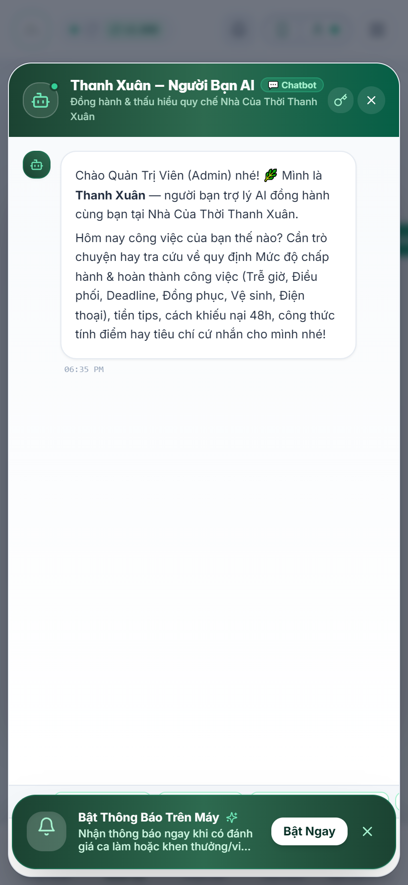
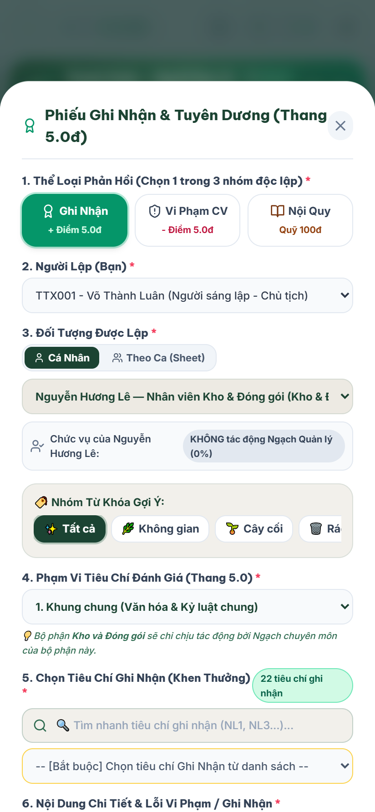
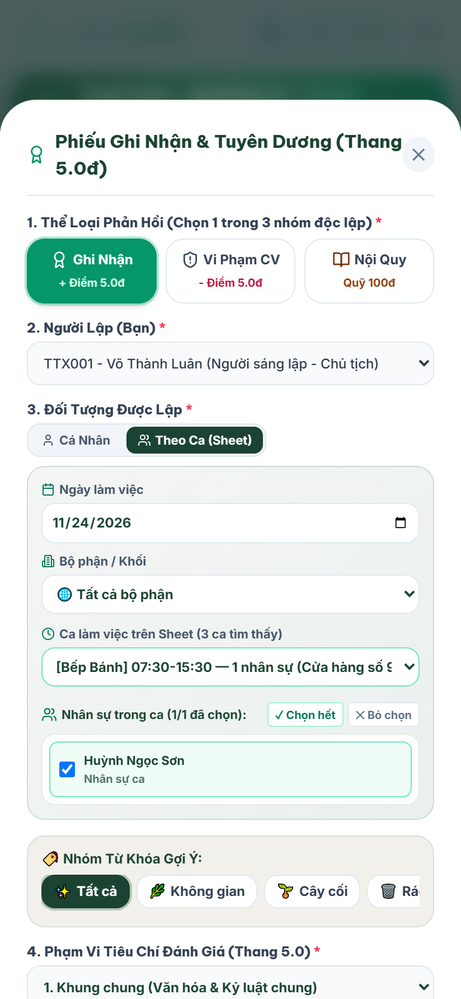
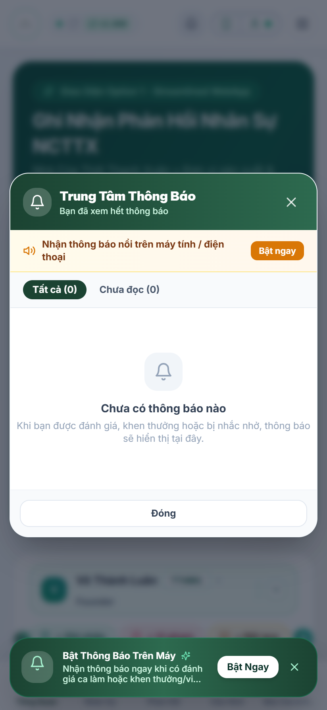

# HƯỚNG DẪN THAO TÁC HỆ THỐNG ĐÁNH GIÁ NHÂN SỰ STAFFPOINT
### QUY TRÌNH THAO TÁC CHUẨN (SOP) DÀNH CHO NHÂN VIÊN VÀ QUẢN LÝ CA
**CÔNG TY TNHH NHÀ CỦA THỜI THANH XUÂN**  
*Phiên bản hệ thống: v1.041 | Nền tảng: Web App & PWA Di Động*

---

> **MỤC ĐÍCH & PHẠM VI ÁP DỤNG:**  
> Tài liệu này quy định chi tiết các bước thao tác trên phần mềm **NCTTX StaffPoint** phục vụ công tác:  
> 1. Cài đặt ứng dụng trên thiết bị di động cá nhân (PWA).  
> 2. Đăng nhập và bảo mật thông tin tài khoản.  
> 3. Theo dõi bảng điểm năng lực, xếp bậc lương và quỹ điểm chấp hành nội quy.  
> 4. Quy trình lập phiếu ghi nhận khen thưởng, biên bản vi phạm chuyên môn hoặc nội quy.  
> 5. Thao tác chấm điểm đồng loạt theo ca làm việc từ lịch Google Sheet.  
> 6. Quy trình tiếp nhận thông báo và quyền kháng nghị trong thời hạn 48 giờ.

---

## 📑 MỤC LỤC
1. [Cài đặt ứng dụng trên thiết bị di động (PWA)](#1-cài-đặt-ứng-dụng-trên-thiết-bị-di-động-pwa)
2. [Đăng nhập và bảo mật tài khoản](#2-đăng-nhập-và-bảo-mật-tài-khoản)
3. [Cơ cấu điểm số, xếp bậc lương và quỹ 100 điểm nội quy](#3-cơ-cấu-điểm-số-xếp-bậc-lương-và-quỹ-100-điểm-nội-quy)
4. [Quy trình lập phiếu phản hồi (3 nghiệp vụ cốt lõi)](#4-quy-trình-lập-phiếu-phản-hồi-3-nghiệp-vụ-cốt-lõi)
5. [Chấm điểm đồng loạt theo ca làm việc (Dữ liệu Google Sheet)](#5-chấm-điểm-đồng-loạt-theo-ca-làm-việc-dữ-liệu-google-sheet)
6. [Trung tâm thông báo và thời hạn kháng nghị 48 giờ](#6-trung-tâm-thông-báo-và-thời-hạn-kháng-nghị-48-giờ)
7. [Tra cứu sổ nhật ký và quy tắc mã định danh phiếu](#7-tra-cứu-sổ-nhật-ký-và-quy-tắc-mã-định-danh-phiếu)
8. [Tra cứu quy định và tiêu chuẩn qua Trợ lý AI](#8-tra-cứu-quy-định-và-tiêu-chuẩn-qua-trợ-lý-ai)
9. [Xử lý các tình huống kỹ thuật thường gặp (FAQ)](#9-xử-lý-các-tình-huống-kỹ-thuật-thường-gặp-faq)

---

## 1. CÀI ĐẶT ỨNG DỤNG TRÊN THIẾT BỊ DI ĐỘNG (PWA)

Ứng dụng **NCTTX StaffPoint** được triển khai theo mô hình Progressive Web App (PWA). Người dùng không cần cài đặt thông qua App Store hoặc Google Play, mà thực hiện ghim trực tiếp liên kết lên màn hình chính thiết bị:

* **Máy chủ chính thức:** `https://ncttx-staffpoint.vercel.app/`
* **Máy chủ dự phòng:** `https://fongshubvn-cyber.github.io/ncttx-staffpoint/`

*Hình 1: Hộp thoại hướng dẫn ghim ứng dụng lên màn hình chính thiết bị di động.*

### 1.1. Thao tác trên hệ điều hành iOS (iPhone / iPad):
1. Mở liên kết trên bằng trình duyệt **Safari**.
2. Nhấn nút **Chia sẻ** (biểu tượng hình vuông có mũi tên chỉ lên) trên thanh công cụ Safari.
3. Chọn mục **"Thêm vào MH chính"** (Add to Home Screen ➕).
4. Nhấn **"Thêm"** ở góc trên bên phải. Biểu tượng ứng dụng sẽ xuất hiện trên màn hình chính.

### 1.2. Thao tác trên hệ điều hành Android:
1. Mở liên kết trên bằng trình duyệt **Google Chrome**.
2. Nhấn biểu tượng **Tùy chọn** (dấu ba chấm dọc ⋮ ở góc trên bên phải).
3. Chọn **"Cài đặt ứng dụng"** hoặc **"Thêm vào Màn hình chính"**.
4. Xác nhận **"Cài đặt"**.

---

## 2. ĐĂNG NHẬP VÀ BẢO MẬT TÀI KHOẢN

*Hình 2: Giao diện xác thực tài khoản đăng nhập hệ thống.*

### 2.1. Quy trình đăng nhập
1. **Mã số nhân viên:** Nhập chính xác mã cá nhân được cấp (ví dụ: `TTX005`, `TTX009`, `TTX012`...). Hệ thống tự động chuyển đổi thành chữ in hoa.
2. **Mật khẩu khởi tạo mặc định:** `123456`.
3. **Lưu phiên làm việc:** Tích chọn ô *"Ghi nhớ đăng nhập trọn đời"* để duy trì phiên xác thực an toàn trên thiết bị cá nhân.
4. **Xác nhận:** Nhấn nút **"Đăng Nhập"** để chuyển vào giao diện làm việc chính.

### 2.2. Quy trình đổi mật khẩu bắt buộc
Tại lần đăng nhập đầu tiên bằng mật khẩu mặc định (`123456`), hệ thống tự động kích hoạt màn hình đổi mật khẩu bắt buộc. Nhân sự cần thiết lập mật khẩu mới có độ dài tối thiểu 6 ký tự (không được trùng với mật khẩu mặc định `123456`).

> **XỬ LÝ QUÊN MẬT KHẨU:**  
> Trường hợp quên mật khẩu cá nhân, nhân sự liên hệ Trưởng phòng Nhân sự hoặc Quản trị viên hệ thống để thực hiện khôi phục (reset) mật khẩu về mặc định `123456`.

---

## 3. CƠ CẤU ĐIỂM SỐ, XẾP BẬC LƯƠNG VÀ QUỸ 100 ĐIỂM NỘI QUY

Hệ thống quản lý điểm số gồm **02 cấu phần đánh giá độc lập**:

| Bảng điều khiển Tổng quan | Phân tích Cấu phần Điểm số |
| :---: | :---: |
|  |  |
| *Hình 3: Bảng điều khiển Tổng quan điểm số và bậc lương* | *Hình 4: Chi tiết cấu phần điểm Văn hóa (70%) & Chuyên môn (30%)* |

### 3.1. Điểm Năng lực & Chuyên môn (Thang điểm 5.0)
* **Công thức tính trọng số:**
  $$\text{Điểm Tổng} = (\text{Điểm Khung Chung} \times 70\%) + (\text{Điểm Ngạch Chuyên Môn} \times 30\%)$$
* **Khung Chung (Tỷ trọng 70%):** Bao gồm các tiêu chuẩn chung áp dụng cho mọi vị trí: Giữ gìn trật tự và không gian làm việc; chăm sóc bảo vệ tài sản, cảnh quan; thực hiện phân loại và xử lý rác thải đúng quy định; tác phong phối hợp làm việc.
* **Ngạch Chuyên Môn (Tỷ trọng 30%):** Bao gồm các chỉ số chuyên biệt theo vị trí đảm nhiệm: Pha chế, Bếp bánh, Dịch vụ & Phục vụ, Sản xuất xưởng, Kho và Đóng gói...

#### Bảng Quy chuẩn Xếp Bậc Lương Theo Điểm Tổng Hợp:
| Bậc Lương | Khoảng Điểm Tổng | Hệ Số Lương | Phân Loại Đánh Giá |
| :--- | :--- | :--- | :--- |
| **Bậc 5** | 4.80 - 5.00 điểm | **1.05** | Xuất sắc / Vượt chuẩn |
| **Bậc 4** | 4.50 - 4.79 điểm | **1.00** | Hoàn thành tốt / Đạt chuẩn |
| **Bậc 3** | 4.00 - 4.49 điểm | **0.95** | Đạt yêu cầu cơ bản |
| **Bậc 2** | 3.50 - 3.99 điểm | **0.90** | Cần cải thiện chất lượng |
| **Bậc 1** | Dưới 3.50 điểm | **0.85** | Tập sự / Cần kèm cặp |

### 3.2. Quỹ Điểm Chấp Hành Nội Quy (Quỹ 100 điểm)
* Vào ngày đầu tiên của mỗi chu kỳ đánh giá (tháng), mỗi nhân sự được phân bổ định mức **100 điểm**.
* Các hành vi vi phạm nội quy lao động (giờ giấc, đồng phục, an toàn lao động, vệ sinh, hút thuốc không đúng nơi quy định...) sẽ bị trừ điểm trực tiếp theo biểu khung chế tài.
* Điểm còn lại của Quỹ 100 điểm tại thời điểm chốt kỳ là căn cứ xét thưởng Chuyên cần và đánh giá kỷ luật.

*Hình 5: Danh mục nhân sự toàn hệ thống theo phòng ban và trạng thái.*

---

## 4. QUY TRÌNH LẬP PHIẾU PHẢN HỒI (3 NGHIỆP VỤ CỐT LÕI)

Nhấn nút tác vụ nổi **`[ ＋ ]`** tại góc dưới màn hình. Hệ thống hiển thị 03 nghiệp vụ phản hồi chuẩn:

| Menu 3 Nghiệp Vụ Cốt Lõi | Biểu Mẫu Nhập Liệu Cá Nhân |
| :---: | :---: |
|  |  |
| *Hình 6: Hộp thoại lựa chọn 3 nghiệp vụ phản hồi cốt lõi* | *Hình 7: Biểu mẫu nhập liệu phản hồi cho đối tượng Cá Nhân* |

### 4.1. Phân loại 3 nghiệp vụ:
1. **Nghiệp vụ 1 - Ghi nhận & Khen thưởng:** Áp dụng ghi nhận đóng góp tích cực, hỗ trợ đồng đội hoặc sáng kiến cải tiến. Tác động cộng điểm vào Thang điểm 5.0.
2. **Nghiệp vụ 2 - Vi phạm tiêu chuẩn công việc:** Áp dụng khi phát hiện sai sót quy trình kỹ thuật, sự cố công việc hoặc chất lượng chưa đạt. Tác động trừ điểm trong Thang điểm 5.0.
3. **Nghiệp vụ 3 - Đánh giá nội quy - chấp hành:** Áp dụng đối với các hành vi vi phạm nội quy lao động, trật tự, giờ giấc, trang phục. Tác động trừ điểm trực tiếp vào Quỹ 100 điểm.

### 4.2. Quy trình 7 bước thực hiện:
* **Bước 1 (Thể loại):** Chọn 1 trong 3 nhóm nghiệp vụ nêu trên.
* **Bước 2 (Người lập):** Hệ thống tự động trích xuất thông tin nhân sự đang đăng nhập.
* **Bước 3 (Đối tượng):** Chọn `[ 👤 Cá Nhân ]` (đánh giá 1 nhân sự) hoặc `[ 👥 Theo Ca (Sheet) ]` (đánh giá tập thể ca).
* **Bước 4 (Phạm vi & Tiêu chí):** Lựa chọn tiêu chí đánh giá chuẩn thông qua danh mục từ khóa hoặc thanh tìm kiếm.
* **Bước 5 (Mô tả):** Nhập cụ thể thời gian, địa điểm, diễn biến sự việc và biện pháp xử lý đã thực hiện.
* **Bước 6 (Minh chứng):** Tải tệp hình ảnh minh chứng nếu có (dung lượng tối đa 10MB/tệp).
* **Bước 7 (Phát hành):** Nhấn nút hoàn tất để ghi nhận vào hệ thống đám mây (Cloud Database) và phát hành mã phiếu định danh.

---

## 5. CHẤM ĐIỂM ĐỒNG LOẠT THEO CA LÀM VIỆC (DỮ LIỆU GOOGLE SHEET)

Tính năng hỗ trợ Quản lý ca hoặc người kiểm tra thực hiện đánh giá đồng loạt toàn bộ nhân sự tham gia ca làm việc:

*Hình 8: Giao diện chấm điểm đồng loạt theo ca làm việc đồng bộ từ Google Sheet.*

1. **Kích hoạt:** Tại Bước 3 của Form lập phiếu, nhấn chọn tab **`[ 👥 Theo Ca (Sheet) ]`**.
2. **Chọn ngày:** Chọn ngày đánh giá từ danh sách ngày được đồng bộ tự động từ bảng phân ca Google Sheet của công ty.
3. **Chọn ca:** Lựa chọn Bộ phận chuyên môn (Pha chế, Bếp bánh, Phục vụ...) và Ca làm việc tương ứng (Ca sáng / Ca chiều).
4. **Xác nhận nhân sự:** Hệ thống tự động hiển thị danh sách nhân sự có lịch làm việc trong ca. Người lập có thể bỏ tích chọn đối với nhân sự vắng mặt hoặc chuyển ca.
5. **Cập nhật dữ liệu:** Hệ thống phát hành mã phiếu duy nhất dạng `CA-YYMM-XXX` (ví dụ: `CA-2611-001`) và đồng thời cập nhật điểm số cho toàn bộ nhân sự được chọn.

---

## 6. TRUNG TÂM THÔNG BÁO VÀ THỜI HẠN KHÁNG NGHỊ 48 GIỜ

Quy chế bảo đảm tính khách quan, công bằng và quyền giải trình của nhân sự:

| Trung Tâm Thông Báo (🔔) | Sổ Nhật Ký Phản Hồi |
| :---: | :---: |
|  |  |
| *Hình 9: Trung tâm thông báo và thời hạn khiếu nại trong 48 giờ* | *Hình 10: Sổ nhật ký phản hồi và tra cứu mã phiếu* |

* **Tiếp nhận thông báo:** Khi có phiếu đánh giá liên quan phát sinh, hệ thống kích hoạt thông báo chuông tức thời trên giao diện người dùng kèm chi tiết mã phiếu, người lập, nội dung và điểm tác động.
* **Cửa sổ kháng nghị 48 giờ:** Mọi phiếu nhắc nhở / vi phạm có hiệu lực chờ trong thời hạn 48 giờ kể từ thời điểm phát hành. Trong thời gian này, nhân sự có quyền:
  * Trao đổi trực tiếp với Người lập phiếu để làm rõ các điểm chưa thống nhất.
  * Gửi đơn giải trình hoặc phản ánh đến Trưởng phòng Nhân sự / Quản trị viên hệ thống.
  * Trường hợp xác nhận thông tin phản ánh chưa chính xác hoặc do nguyên nhân khách quan, Quản trị viên có thẩm quyền thu hồi phiếu và hoàn trả điểm số trên hệ thống.

---

## 7. TRA CỨU SỔ NHẬT KÝ VÀ QUY TẮC MÃ ĐỊNH DANH PHIẾU

Mục **"Phản Hồi"** lưu trữ toàn bộ lịch sử các giao dịch đánh giá đã phát sinh. Hệ thống áp dụng cấu trúc mã chuẩn hóa:

| Cấu Trúc Mã Phiếu | Loại Nghiệp Vụ | Quy Chuẩn Tác Động Điểm |
| :--- | :--- | :--- |
| **TD-YYMM-XXX** | Phiếu Tuyên Dương / Khen Thưởng | Cộng điểm trực tiếp vào Thang 5.0 |
| **VP-YYMM-XXX** | Biên Bản Vi Phạm Tiêu Chuẩn Công Việc | Trừ điểm trực tiếp trong Thang 5.0 |
| **NQ-YYMM-XXX** | Biên Bản Vi Phạm Nội Quy Lao Động | Trừ điểm trực tiếp vào Quỹ 100 điểm |
| **CA-YYMM-XXX** | Đánh Giá Tập Thể Ca Làm Việc | Cập nhật Thang 5.0 cho toàn bộ ca |

---

## 8. TRA CỨU QUY ĐỊNH VÀ TIÊU CHUẨN QUA TRỢ LÝ AI

Phân hệ Trợ lý AI tích hợp cơ sở tri thức toàn diện về Nội quy lao động, Sổ tay nhân sự và Tiêu chuẩn vận hành:

*Hình 11: Giao diện tương tác và tra cứu tiêu chuẩn công việc qua Trợ lý AI.*

* **Thao tác kích hoạt:** Nhấn biểu tượng Trợ lý AI (nút tròn góc dưới bên trái màn hình).
* **Thao tác truy vấn:** Nhập câu hỏi bằng tiếng Việt có dấu. Hệ thống tự động đối chiếu cơ sở dữ liệu quy chế và phản hồi điều khoản, mức phạt hoặc tiêu chuẩn kỹ thuật tương ứng.

---

## 9. XỬ LÝ CÁC TÌNH HUỐNG KỸ THUẬT THƯỜNG GẶP (FAQ)

### 9.1. Nhân sự khiếm thính thao tác trên phần mềm như thế nào?
> **Trả lời:** Toàn bộ giao diện được thiết kế trực quan hóa 100%, hỗ trợ phân loại màu sắc tiêu chuẩn (xanh: khen thưởng, đỏ: vi phạm, vàng: nội quy) và danh mục gợi ý dạng nút bấm. Không yêu cầu tương tác âm thanh hay giọng nói.

### 9.2. Cấp bậc nhân viên có được lập phiếu đối với cấp Quản lý không?
> **Trả lời:** Hệ thống cho phép nhân sự lập phiếu phản hồi đối với mọi đối tượng trong danh mục nhân sự nhằm duy trì sự minh bạch hai chiều.

### 9.3. Khi xảy ra gián đoạn kết nối Internet (mất mạng Wifi/4G), ứng dụng có hoạt động không?
> **Trả lời:** Ứng dụng trang bị bộ nhớ đệm Offline Cache. Dữ liệu bảng điểm và lịch ca đã tải sẽ duy trì hiển thị cục bộ. Dữ liệu mới sẽ được đồng bộ lên Cloud Database ngay khi thiết bị kết nối mạng trở lại.

### 9.4. Điểm số trên phần mềm tác động đến thu nhập như thế nào?
> **Trả lời:** Điểm tổng hợp Thang điểm 5.0 xác định Bậc lương thực nhận theo hệ số tương ứng quy định tại Mục 3.1 của tài liệu này.
